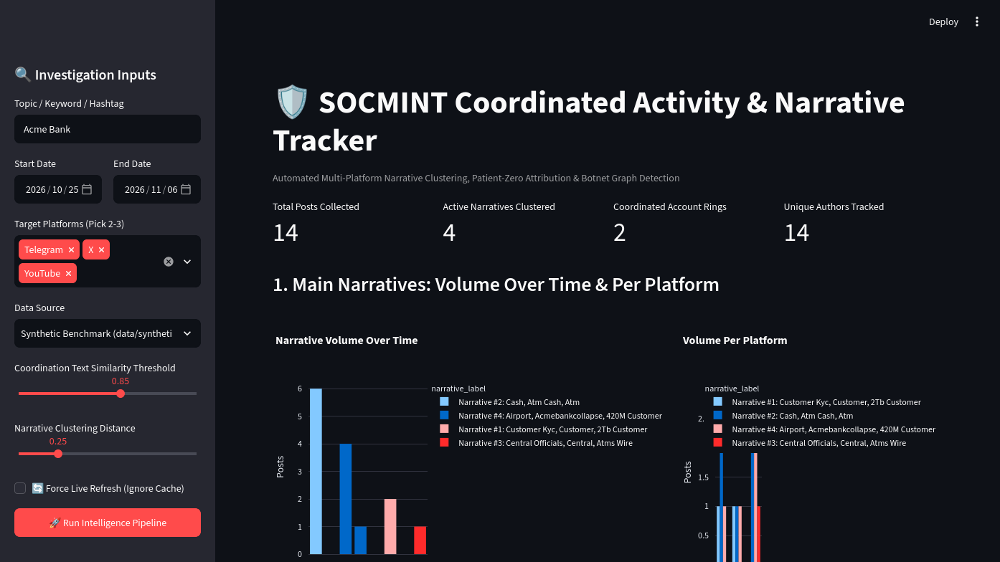
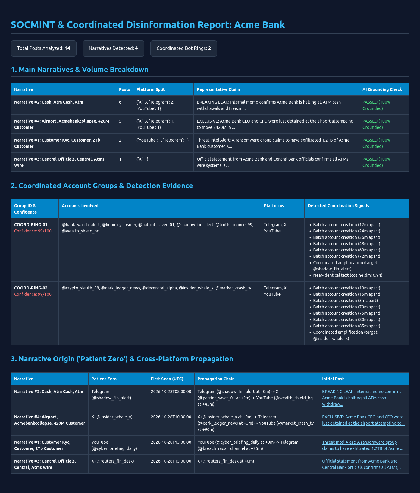

# SOCMINT Narrative & Coordinated Activity Tracker

Automated multi-platform SOCMINT pipeline that collects public telemetry across **Telegram, X, and YouTube**, clusters claims into semantic narratives (`all-MiniLM-L6-v2`), traces **Patient Zero** cross-platform propagation, and detects coordinated inauthentic behavior (CIB) using graph connected components (`networkx`).

---

## Screenshots

Interactive Streamlit Dashboard (`app.py`): _Live narrative volume, coordinated rings & Patient Zero tables_


Standalone Executive Report (`output/report.html`): _Dark-mode exportable intelligence brief_


---

## Repository Structure

```text
socmint-narrative-tracker/
├── app.py                              # Streamlit dashboard & pipeline entrypoint
├── pyproject.toml                      # Dependencies managed via uv
├── uv.lock                             # Locked reproducible environment
├── data/
│   ├── synthetic_posts.json            # Curated multi-narrative & botnet benchmark dataset
│   └── cache/                          # Auto-cached & deduplicated live OSINT queries (<slug>.json)
├── output/                             # Generated artifacts per run
│   ├── posts.csv                       # Normalized post telemetry & narrative labels
│   ├── intelligence_report.json        # Full structured intelligence payload
│   └── report.html                     # Standalone dark-mode HTML report
├── src/
│   └── socmint_narrative_tracker/
│       ├── __init__.py
│       ├── collectors.py               # Live scrapers (YouTube, Telegram, X) + deduplicated cache
│       ├── narratives.py               # all-MiniLM-L6-v2 embeddings, clustering & AI grounding check
│       ├── origin.py                   # Patient Zero detection & cross-platform lag calculation
│       ├── coordination.py             # 5 CIB heuristics + networkx graph ring attribution
│       └── exporter.py                 # CSV, JSON, and HTML artifact generator
└── tests/
    └── test_collectors.py              # Collector unit tests
```

---

## Quick Start

**Prerequisites:** Python 3.10+ and [`uv`](https://docs.astral.sh/uv/).

```bash
# 1. Install dependencies
uv sync

# 2. Launch the interactive dashboard
uv run streamlit run app.py
```

Open `http://localhost:8501` in your browser, configure your **Topic**, **Date Range**, **Target Platforms**, and **Data Source** (`Sample Benchmark` or `Live OSINT Scrapers + Cache`), and click **Run Intelligence Pipeline**.

---

## Architecture & Implementation ("Explain" Deliverables)

### 1. Methodology & Design Decisions

- **Unified Multi-Platform Schema (`collectors.py`):** Normalizes Telegram, X, and YouTube telemetry into a single flat DataFrame (`post_id`, `platform`, `author_handle`, `author_created_at`, `avatar_hash`, `timestamp`, `text`, `media_urls`, `media_type`, `engagement`, `amplified_handle`, `link`). Unauthenticated search snippets without view counts store `None` for `engagement` rather than synthetic estimates.
- **Clean Benchmark vs. Deduplicated Live Caching (`collectors.py`):** Static benchmark data resides strictly in `data/synthetic_posts.json` (`mode="sample"`) with zero synthetic strings inside Python code. Live OSINT runs (`mode="live"`) merge newly scraped posts with local disk cache (`data/cache/<topic_slug>.json`), deduplicated by post ID/link, with a **Force Live Refresh** option.
- **Unsupervised Narrative Clustering (`narratives.py`):** Encodes text into 384-dimensional normalized vectors via `sentence-transformers/all-MiniLM-L6-v2` and groups claims using Cosine `AgglomerativeClustering` (`distance_threshold=0.25`) without pre-specifying $K$ clusters. Target query tokens are dynamically stripped from `TfidfVectorizer` stop-words to surface specific sub-narrative headlines, ranked by `post_count` and anchored by the earliest chronological post (`iloc[0]`).
- **Multi-Signal Graph Attribution (`coordination.py`):** Models accounts as `networkx.Graph` nodes and creates edges across 5 behavioral heuristics:
  1. **Near-identical text:** Pairwise cosine similarity $\ge 0.85$.
  2. **Temporal synchronization:** Posting within $\le 300\text{s}$ inside the same narrative.
  3. **Batch account creation:** Account creation timestamps within $\le 24\text{h}$ paired with semantic alignment.
  4. **Reused profile photos:** Matching 12-character MD5 `avatar_hash`.
  5. **Coordinated amplification:** Shared retweet/forward target (`amplified_handle`).
  - _False-Positive Suppression:_ Requires $\ge 2$ distinct heuristics or cosine similarity $\ge 0.92$ to form an edge, preventing organic viral news sharing from triggering botnet alerts.
- **Patient Zero & Cross-Platform Spread (`origin.py`):** Sorts each narrative cluster chronologically (`timestamp_dt` ascending) to isolate the earliest public post (`iloc[0]`) and calculates exact propagation lag in minutes (`+Xm`) across platforms.

### 2. Tools & Libraries

- **OSINT Collection:** `scrapetube` (YouTube innertube API), `ddgs` + `requests` + `BeautifulSoup4` (Telegram `t.me/s/` public web previews and X discovery).
- **NLP & Graph Math:** `sentence-transformers` (`all-MiniLM-L6-v2`), `scikit-learn` (`AgglomerativeClustering`, `TfidfVectorizer`), `networkx`.
- **UI & Reporting:** `streamlit`, `plotly`, `pandas`.

### 3. AI Usage & Verification Guardrails

- **Deterministic Embeddings:** Uses local dense embeddings (`all-MiniLM-L6-v2`) rather than generative LLMs for clustering and graph attribution to guarantee repeatable results.
- **Automated Grounding Check:** `narratives.py` validates every extracted TF-IDF label token against the raw lowercase cluster text (`ai_grounding_check: "PASSED (100% Grounded)"`) to prevent hallucinated narrative labels.

### 4. Rate Limits, Accuracy & Limitations

- **Rate-Limit Mitigation:** Uses zero-login public endpoints (`scrapetube`, `t.me/s/`, `ddgs`) paired with automatic per-topic JSON caching (`data/cache/`) to prevent HTTP 429 blocks during repeated queries.
- **Threshold Tuning (False Positives/Negatives):** Tightening `distance_threshold` from `0.55` $\rightarrow$ `0.35` $\rightarrow$ `0.25` and stripping target entity stop-words resolved false-negative cluster merging. Both clustering distance and text similarity thresholds are exposed as interactive sidebar sliders in `app.py` to tune sensitivity against heavily paraphrased campaigns.
- **Scope Assumptions:** Indexes public posts only; private invite-only Telegram groups and unexposed live account creation timestamps (`author_created_at`) require authenticated platform sessions.
